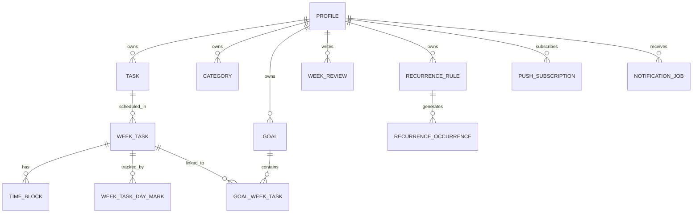

# WEEKFLOW — 제품 요구사항 명세서 (PRD / UX Specification)

> 상태: **기능·UX 결정 완료 / 구현 전 명세**  
> 버전: 1.0.0  
> 작성 기준일: 2026-11-15 (Asia/Seoul)  
> 대상: AI 바이브코딩 에이전트, 제품 오너, QA  
> 연관 문서: `WEEKFLOW_02_IMPLEMENTATION_PLAN.md`, `WEEKFLOW_03_AI_BUILD_PROMPT.md`

## 0. 문서 사용법과 결정 상태

- 이 문서는 대화에서 **확정한 요구사항**을 구현 가능한 규칙으로 정리한다. 추가 승인 없이 바로 개발할 수 있도록 애매한 부분에는 명시적인 **기본 구현 정책**을 지정했다.
- **출시 범위:** 아래 기능 모두를 **첫 정식 릴리스**에 포함한다. 개발 작업은 안전을 위해 순차적으로 진행하되 일부 기능을 '나중에'로 임의 제외하지 않는다.
- 서비스명 **WEEKFLOW는 임시 프로젝트명**이다. WORKIVE의 로고·상표·전용 이미지·고유 문구·상용 서체 파일은 복제하거나 배포하지 않는다. 사용자가 제공한 이미지의 **레이아웃·시각적 원칙·기록 방식**을 참고해 독립된 웹 UI를 개발한다.
- 기준 레퍼런스: 사용자가 제공한 WORKIVE 위클리 플래너 Instagram 스크린샷 5장. AI 코딩 세션에도 해당 이미지들을 첨부해야 시각적 일치도를 검증할 수 있다.
- 이 문서는 **코드가 이미 완성되었다는 의미가 아니다.** 배포에는 소유자의 GitHub·Google Cloud·Supabase·공공데이터포털 계정 설정이 필요하다.

### 0.1 제품 한 줄 설명

> 할 일(To-do)을 이번 주의 실제 가능한 시간에 끌어 배치하고, 요일별 수행·시간 블록 완료·목표·마감·회고를 한 장의 종이형 플래너에서 관리하는 개인용 한국어 웹서비스.

### 0.2 핵심 가치와 제품 원칙

1. **Capture → Plan → Do → Review → Carry**: 생각나는 할 일을 빠르게 적고, 가능한 시간을 찾아 배치하고, 실제 수행을 체크하고, 회고하고, 미완료 작업을 선별 이월한다.
2. **단일 데이터 원본:** 같은 일을 GOALS, DEADLINE, TO-DO, 시간표에 중복 저장하지 않는다. 연결 관계를 통해 다양한 위치에 표시한다.
3. **종이 다이어리 감성:** 아이보리 배경, 가는 격자, 잔잔한 파스텔 작업 블록, 형광 연두 강조. 카드형 SaaS 대시보드로 변질되지 않는다.
4. **사용자 의사 존중:** 충돌·완료·이월·삭제·데이터 복구에서 사용자의 선택 없이 위험한 자동 변경을 하지 않는다.
5. **개인정보 보호:** Google 로그인 필수, 데이터는 사용자별 분리, 비밀키는 브라우저/저장소에 노출하지 않는다.
6. **0원 시작:** GitHub Pages + Supabase 무료 플랜 + 공식 공휴일 API. 무료 플랜에서의 중지·지연·제한은 사실대로 안내한다.

### 0.3 확정 결정 요약

| 항목 | 최종 결정 |
|---|---|
| UI | 제공된 종이형 위클리 플래너 레퍼런스를 높은 충실도로 재현하되 브랜드 자산은 재사용하지 않음 |
| 핵심 구조 | 월~일 7일 타임테이블 + 우측 GOALS/DEADLINE/TO-DO + 하단 WEEKLY REVIEW |
| Todo ↔ 시간표 | 양방향 연결. Todo 하나를 여러 시간 블록으로 분할 배치 가능 |
| 고정 일정 | Todo와 구분되는 Event. 타임테이블에서 직접 생성 |
| 사용 가능 시간 | 요일별 기본 활동시간에서 자동 계산 + 특정 날짜 수동 수정 |
| 일정 겹침 | 사전 경고·충돌 시각화, 사용자가 승인하면 저장 허용 |
| 미완료 이월 | 다음 주 진입 시 이월 제안, 사용자가 항목별 선택 |
| 완료 | Todo 전체 완료와 시간 블록별 완료를 각각 지원 |
| GOALS | Todo와 선택적으로 연결, 연동된 Todo 기반 달성률 |
| DEADLINE | Todo의 마감일을 자동 집계, 쌍방 수정 동기화 |
| REVIEW | 완료 통계 자동 계산 + 잘한 점·아쉬운 점·개선점 직접 입력 |
| 빠른 입력 | 인라인 입력 + Enter 저장, 상세 설정 팝오버 |
| 일정 편집 | 클릭 팝오버, 드래그 이동·크기 조절, 실행 취소 |
| 드래그 | 15분 스냅, 반투명 미리보기, 유효성 확인, 충돌 승인 |
| 모바일 | 하루 집중형 + 날짜 탭 + Todo 바텀시트; 터치 대체 조작 제공 |
| 반복 | 고정 일정과 Todo 모두 매일·평일·선택 요일 반복 |
| 카테고리 | 사용자가 변경 가능한 카테고리 + 자동 파스텔 색상 |
| 인증 | Google 로그인 필수 (게스트 모드 없음) |
| 주간 설정 | 월요일 시작, 04:00~24:00 시간표, 15분, 평일 기본 09:00~18:00 |
| 공휴일 | 한국천문연구원 특일 API, 주말·대체공휴일 구분, 휴일명 표시 |
| 알림 | 앱 내부 알림 + 실제 브라우저 Web Push + 설정/권한 관리 |
| 백업 | 전체 JSON 내보내기·가져오기 + Todo CSV 내보내기 |
| 범위 | **위 기능 모두 첫 출시**. 순차 구현은 허용하되 범위 축소는 금지 |

## 1. 사용자, 맥락, 목표

- 1차 이용자: 개인이 업무·공부·운동·일상 계획을 하나의 주간 화면에서 정리한다.
- 핵심 사용 환경: 노트북/데스크톱 웹을 기본으로, 스마트폰에서 하루 일정을 확인·체크·수정한다.
- 핵심 작업: 일요일 밤/월요일 아침 주간 계획, 매일 시간 블록 실행, 주말 회고 및 다음 주 이월.
- 현재 제외: 조직 멤버 초대, 공유 캘린더, 공동 편집, 결제, AI 모델 호출, Google Calendar API 양방향 동기화, 시간 추적 타이머. 사용자 요청 없이 추가하지 않는다.
- 데이터는 기기 간 동기화하고, 표준 시간대는 `Asia/Seoul`이다. 시간대 설정 변경 기능은 제공한다.

## 2. 정보 구조 및 페이지

| 경로/화면 | 기능 |
|---|---|
| `/` 또는 `/#/planner` | 로그인 여부에 따라 로그인 화면 / 이번 주 플래너 |
| 로그인 화면 | Google 로그인 버튼, 서비스 소개 및 개인정보 안내 |
| 주간 플래너 | 기본 메인: 헤더, 요일별 가용 시간, 타임라인, 우측 패널, 주간 회고 |
| Todo 상세 팝오버 | 제목, 설명, 카테고리, 목표, 마감일, 예상 소요, 반복, 완료, 삭제 |
| Event 상세 팝오버 | 제목, 날짜, 시작/종료, 고정 여부, 카테고리, 반복, 알림, 삭제 |
| 리뷰 편집 영역 | 자동 통계, 3개 회고 질문, 확정/재계산 명령 |
| 설정 패널 | 기본 시간표, 반복, 범주, 알림, PWA 설치, 백업, 계정 삭제 |
| 모바일 Todo 바텀시트 | Todo·마감·목표 탭 및 시간표 배치 동작 |
| 계정/알림 상태 | 온라인/오프라인, 동기화 실패, 푸시 구독 상태 |

### 2.1 PC 화면 배치

```text
┌────────────────────── WEEKFLOW / 2026 NOV / 주차 / 이전·오늘·다음 ─────────────────────┐
│ 날짜 범위 · 월/주 이동 · 공휴일 정보 · 동기화 상태 · 설정                           │
├────────────────────────────────────────────────────┬─────────────────────────────┤
│      MON   TUE   WED   THU   FRI   SAT   SUN         │ GOALS                       │
│      날짜 / 가용 시간 / 공휴일명                     │ 이번 주 목표 + 진행률        │
│ 04  ────────────────────────────────────────────    ├─────────────────────────────┤
│ 05  ─────── 시간별 얇은 격자 / 15분 스냅 ────────    │ DEADLINE                    │
│ 06  ─── 파스텔 고정 일정 / 작업 블록 ───────────    │ Todo 원본의 마감 항목 조회   │
│  ... 점선 집중 가능 시간 / 시간표 드래그 ───────    ├─────────────────────────────┤
│ 23  ────────────────────────────────────────────    │ TO-DO                       │
│ 24  ────────────────────────────────────────────    │ [M T W T F S S] TASK        │
│                                                   │ [· X ─ ─ ─ ─ ─] 제목       │
│                                                   │ + 인라인 새 작업 입력        │
├────────────────────────────────────────────────────┴─────────────────────────────┤
│ WEEKLY REVIEW · 자동 수치 / 잘한 점 / 아쉬운 점 / 다음 주 개선점                  │
└───────────────────────────────────────────────────────────────────────────────────┘
```

- 7일 열은 항상 동일한 폭 비율. 우측 패널은 데스크톱 300~340px 선에서 가독성을 확보한다.
- 작은 노트북: 시간표에 내부 가로 스크롤을 허용하고 오른쪽 패널은 접을 수 있다. 스크롤해도 날짜 헤더·시간축은 가능한 범위에서 고정한다.
- 타임라인 높이는 시간에 비례한다. 1시간 블록의 시각적 높이를 일관되게 정의하고 과밀하면 확대/축소(예: 48/64/80px per hour) 설정을 지원한다.
- 빈 상태도 실제 레퍼런스처럼 빈 격자와 선 중심으로 표시. 샘플 작업은 사용자가 명시적으로 체험 버튼을 눌렀을 때만 메모리에서 보여주며 계정 DB에 자동 저장하지 않는다.
- 마감·목표·할 일을 별도 커다란 카드로 분리하지 말고 하나의 종이 면에 가는 구분선으로 나눈다.

### 2.2 모바일 화면 배치

- 767px 이하: 하루 집중형. 요일 7개 선택 스트립, 하루 04:00~24:00 세로 타임라인.
- 우측 패널 대신 하단 `TO-DO` 버튼/탭 → 바텀시트. GOALS·DEADLINE은 시트 내 섹션으로 접근.
- 날짜 좌우 스와이프 또는 요일 탭으로 이동, 현재 주/날짜 표시.
- 작업 탭 → `시간표에 배치` → 날짜/시작/종료 선택으로 드래그와 **동등한 기능** 제공.
- 바텀시트와 팝오버는 키보드로도 사용 가능하며 닫을 때 원래 포커스로 복원.
- 모바일에서 정확한 15분 위치 드래그는 강제하지 않는다. 터치 환경에 적합한 시간 선택기를 주 경로로 둔다.

## 3. 시각 디자인 시스템

### 3.1 디자인 토큰 (초기값, 레퍼런스 이미지 대비 미세 조정 허용)

```css
:root {
  --paper: #F7F6EF;
  --paper-raised: #FFFEFA;
  --ink: #272723;
  --ink-muted: #77776F;
  --grid: #E0DED5;
  --grid-strong: #BDBBB2;
  --lime: #D9EE83;
  --peach: #F1C9B9;
  --sage: #DBE8BD;
  --sky: #CBDDEA;
  --lavender: #E5D7EB;
  --sand: #EADFBD;
  --gray-block: #DFE0DC;
  --saturday: #557FA7;
  --sunday-holiday: #B9574D;
  --danger: #B54F44;
  --focus-ring: #596C32;
  --hairline: 1px;
  --radius-small: 3px;
}
```

- 문서 전체 종이 질감은 **색·여백·격자** 중심으로 재현. 과한 노이즈·스큐어모피즘·그림자 금지.
- 영문 라벨(예: `GOALS`, `DEADLINE`, `TO-DO`, `WEEKLY REVIEW`)은 작고 굵게, 일정명은 가독성을 우선한 한글 폰트.
- 라이선스 확인된 무료/시스템 서체만 사용. WORKIVE의 특정 폰트 파일을 무단 추출하지 않는다.
- 전체 레이아웃은 평면적이며 모서리 곡률은 0~4px 수준. 팝오버·바텀시트만 작게 반경 적용.
- 오늘 날짜는 라임 아웃라인/상단 인디케이터로 표시, 일요일과 공휴일은 붉은색, 토요일은 푸른색, 겹치는 공휴일은 공휴일 표시 우선.
- 일정 완료: 원색 유지 + 채도/불투명도 낮춤 + X/체크. 색상만으로 의미를 전달하지 않는다.
- 스크린리더·키보드 접근, 터치 목표 영역 최소 약 44×44px, 축소 레이블에도 충분한 대비를 지킨다.

## 4. 기능 요구사항 (동작 정의 + 식별자)

### FR-01 인증·개인화

- Google 로그인 필수. 익명·게스트 데이터 저장 모드는 제공하지 않는다.
- 로그인 직후 최초 사용자에게 설정 마법사: 시간대(기본 서울), 주 시작(월), 시간표 범위(04~24), 평일 활동시간(09~18), 알림 기본 비활성.
- 신규 계정에서 카테고리 6개(WORK/PERSONAL/STUDY/HEALTH/ROUTINE/OTHER)를 사용자 소유로 생성한다. 사용자 수정 가능.
- 로그아웃 시 사용자 데이터·오프라인 캐시 및 푸시 구독 정리 정책을 명시하고 다른 계정의 정보가 보이지 않도록 한다.

### FR-02 날짜·주간 탐색

- ISO 주 개념(월요일 00:00 시작), 이전/다음 주, 오늘 돌아가기, 연도/월/주 선택.
- 한 주가 월·연도를 걸쳐도 월~일 7칸을 정확히 표시한다.
- 주간 변경 시 해당 주 Todo·블록·Goal·리뷰·마감·공휴일을 불러온다. 미래 주도 탐색 가능.
- 상태 바는 마지막 저장, 오프라인 대기, 저장 실패를 구분한다.

### FR-03 Todo 빠른 입력·편집

- 우측 TO-DO에서 인라인 제목 입력 후 Enter로 즉시 생성(기본 현재 주, `open`). 빈칸·공백 제목은 저장 불가.
- 클릭 팝오버: 제목/메모/예상 소요(15분 단위)/카테고리/선택적 목표/마감일/반복/삭제/완료.
- `N` 키로 빠른 추가(단, 다른 입력 필드에 포커스가 없을 때만), `Esc`는 취소·팝오버 닫기.
- 하나의 Todo를 다른 날짜/시간에 여러 번 배치할 수 있으며 원본 Todo는 하나만 유지한다.
- Todo 삭제 시 연결 블록의 처리 방식을 보여주고 승인 후 관련 일정·관계 제거(서버 트랜잭션). 실수 직후 Undo 가능.

### FR-04 고정 일정(Event)과 Task 블록

- Event: 회의·약속·수업 등. Todo가 필요 없으며 시간표에서 빈 구간 클릭/드래그로 생성.
- Task block: Todo에 연결된 실제 계획 시간. `task → weekly_task → time_block`으로 연결.
- 블록 드래그: 위아래는 시작 시간 이동, 좌우는 요일 변경; 위·아래 핸들로 길이 조절.
- 드래그 중 반투명 미리보기 + 선택 날짜/시작/종료 표시. 시간 스냅은 **15분**, 종료는 시작보다 늦어야 한다.
- 동일 Todo를 시간표로 다시 끌면 **새 블록 추가**. 기존 블록 이동/복제는 서로 다른 명령.
- Event를 편집해도 Todo가 생기지 않는다. Task 블록을 삭제해도 원본 Todo는 남는다.
- 겹침: 충돌 목록/시간을 표시하고 `취소` / `겹쳐서 배치` 선택. 허용 후 겹침 스타일과 접근 가능한 설명 제공.
- 가용 시간 밖에 배치할 때도 별도 부드러운 경고를 표시하되 금지하지 않는다.
- 자정 넘는 일정은 한 레코드로 저장하되 화면에는 날짜별 구간으로 분할 렌더링한다.

### FR-05 가용 시간 자동 계산 + 수동 조정

- 사용자 주간 규칙: 평일 09:00~18:00, 주말·공휴일은 기본 0분. 요일별 다중 시간 구간 설정 가능(예: 09~12, 13~18).
- 특정 날짜 예외(`기본 적용` / `사용 가능 시간 직접 지정` / `하루 휴무`)를 제공한다. **특정 날짜 수동값이 공휴일 기본값보다 우선**한다.
- 분 단위 계산은 겹치는 구간을 **합집합**으로 처리하고 중복 차감을 금지한다.
- `기본 가용 구간` → 고정 Event와 수동 불가시간을 제외 = `집중 가능 시간`.
- 집중 가능 시간에서 계획된 Task 블록의 겹치지 않는 점유 구간을 제외 = `아직 비어 있는 시간`.
- 두 수치는 구분해서 표시. Todo 블록이 가용 구간 밖에 있다고 해서 마이너스 시간이 되지 않는다.
- 계획된 Task끼리 겹쳐도 서로 다른 분을 중복 차감하지 않는다. 경고는 유지한다.
- 해당 요일 헤더에 `8h 사용 가능` 같은 수치와 집중 가능 구간 점선 미리보기를 표시한다.

### FR-06 두 종류의 완료 상태

- 시간 블록별 `planned / done / skipped`를 저장하고 사용자가 직접 누를 때만 상태 변경. 종료 시간이 지났다는 이유로 자동 완료하지 않는다.
- Todo 전체도 별도 `open / done` 상태. 연결 블록 모두 완료 시 Todo 완료 **제안**만 한다.
- 사용자가 Todo를 먼저 완료하면 미래 미완료 블록에 대해 `남김/취소 처리`를 확인하고, **실제 수행한 것으로 허위 완료 처리하지 않는다**.
- 체크 해제는 가능한 범위에서 되돌릴 수 있고 변경 이력/Undo를 제공한다.
- 주간 요약의 `완료한 계획 시간`은 **완료 처리된 블록 길이의 합**이며 실측한 집중 시간이 아니라고 명시한다.

### FR-07 레퍼런스형 7칸 Todo 기록표 (확정)

- 오른쪽 TO-DO 각 행 왼쪽에 `M T W T F S S` 7칸, 우측에 카테고리 색점·작업명. 오늘 요일은 은은하게 강조.
- **● 점:** 그 요일에 할 계획을 명시했거나 연결된 시간 블록이 예약됨.
- **X:** 그 요일의 수행을 사용자가 명시했거나 연결된 해당 요일 블록을 모두 완료함.
- **일부 수행:** 한 요일의 여러 블록 중 일부만 완료되었다면 별도 `반쪽/점+표시`와 툴팁/접근성 텍스트로 부분 완료를 구분한다. 전체 완료라고 오인시키지 않는다.
- **완전 완료 이후 줄:** Todo를 `done`으로 확정한 날짜의 X를 기준으로 남은 칸에 가는 선을 이어 그린다. **표시 효과일 뿐 실제 날짜 상태를 뒤집지 않는다.**
- 날짜에 별도 수동 수행 체크를 할 수 있으며 해당 기록은 블록의 실제 완료와 구분하여 저장한다.
- 시간이 다른 날로 이동하면 자동 계획 표시도 그 날짜로 따라 이동한다. 수동 표시가 있으면 보존한다.
- Todo가 다음 주로 이월돼도 지난주의 7칸 기록은 `weekly_task` 단위로 보존된다.

### FR-08 GOALS

- 주간 목표 여러 개 작성. Todo 연결은 선택 사항이며 목표 없이 Todo 생성 가능.
- 같은 주의 `weekly_task`에 연결한다. 목표 완료율 = 해당 목표에 연결된 주간 Todo 중 완료 수 / 연결된 Todo 수.
- 연결이 0개인 목표는 `진행 데이터 없음`으로 표시하고 100%로 계산하지 않는다.
- 다음 주 목표는 기본 새로 생성. 필요하면 선택적으로 이전 주 목표 복사.
- 이월한 Todo는 과거 목표 완료율을 사후 변경하지 않으며, 다음 주 목표 연결은 사용자가 선택한다.

### FR-09 DEADLINE

- `tasks.due_on`을 원본으로 사용하고 우측 `DEADLINE`은 계산된 뷰. 동일 마감 건의 별도 복제 금지.
- 마감일 변경은 Todo 팝오버/DEADLINE 양쪽 모두 원본을 수정한다.
- 현재 주 기한과 지연 미완료 항목을 표시. D-1, D-Day, Overdue 배지. 기한이 공휴일이어도 자동으로 옮기지 않음.
- 일자 기준 알림은 사용자 시간대의 로컬 날짜를 기준으로 판단한다.

### FR-10 WEEKLY REVIEW

- 하단 회고: `이번 주 잘한 점`, `아쉬웠던 점`, `다음 주 개선할 점` 3개 작성 칸, 자동 저장.
- 자동 통계: 주간 Todo 완료 수/전체 수, 고정 일정 시간, 계획 Task 블록 시간, 완료 처리된 Task 블록 시간, 목표 달성도, 이월 건수.
- 블록 완료 시간과 실제 측정 집중 시간을 동일시하지 않는다.
- 종료 주의 회고를 확정하면 계산 시점의 통계를 스냅샷으로 저장. 이후 작업 이월·다음 주 완료로 과거 수치를 덮어쓰지 않는다.
- 회고 메모는 확정 후에도 수정 가능. 과거 블록을 의도적으로 수정했다면 `통계 다시 계산`을 수동 제공한다.

### FR-11 미완료 Todo 이월

- 다음 주 첫 방문 시 이전 주의 `open` Todo를 모아 **선택형 제안**으로 표시. 전체 선택/개별 선택/이번에는 닫기.
- 선택 시 **동일 논리 Todo를 다음 주 `weekly_task`에 연결**하고 이전 주 연결 기록은 `carried` 상태로 보존한다.
- 지난주 Time block은 이동·삭제하지 않고 기록 그대로 남긴다. 기한을 자동 변경하지 않는다.
- 이미 다음 주에 연결된 Todo는 이월 중복 생성 불가(유니크 제약 + 멱등 처리).
- 이월하지 않은 과거 Todo는 `open/남겨 둠` 상태로 과거 주에 남고 필요시 나중에 이월 가능.
- 반복 Todo의 각 회차는 별개 Todo다. 반복으로 생성되는 다음 주 회차와 이전 회차를 자동 합치지 않으며, 반복 Todo의 자동 이월은 **기본 제외**. 사용자가 의도적으로 수동 이월할 때는 경고한다.

### FR-12 반복 일정과 반복 Todo

- 패턴: 매일, 평일, 매주 지정 요일, 시작일·종료일/무기한, `공휴일 제외` 선택.
- Event 반복: 각 회차의 시작 시각·길이·카테고리는 원본 패턴에 따르고, 이번 회차 수정은 예외만 적용.
- Todo 반복: 각 회차를 **독립 Todo 및 주간 연결**로 생성, 완료·마감·요일 기록도 독립.
- 편집 범위 `이번 회차만` / `이 회차 이후 모두`. 이후 전체 수정 시 과거 완료/회고/이월 기록은 소급 변경하지 않는다.
- 미래 회차 생성은 **현재 조회 주 + 예약 알림이 필요한 가까운 기간**만 멱등 생성. 무기한 반복을 모든 미래 날짜로 영구 생성하지 않는다.
- 동일 회차 재생성 방지 `unique(series_id, occurrence_date)`.
- 공휴일 데이터가 없으면 `공휴일 제외` 로직의 정확성을 보장할 수 없으므로 해당 기간의 반복 생성은 보류하거나 데이터 미확인 경고와 사용자 승인을 요청한다. 임의로 근무일이라고 단정하지 않는다.

### FR-13 카테고리 및 색상

- 기본: WORK(살구), PERSONAL(연두), STUDY(하늘), HEALTH(라벤더), ROUTINE(모래), OTHER(회색).
- 사용자 카테고리 추가/이름 변경/색 변경/보관 가능. 삭제 시 이미 연결된 작업을 다른 카테고리로 이동하도록 확인.
- Task와 연결 시간 블록은 카테고리 색을 자동 공유. 고정 Event도 카테고리 선택 가능.
- 색상은 식별 보조수단이며 완료/충돌/마감은 아이콘·텍스트로도 표시.

### FR-14 한국 공휴일 API·주말

- 1차 공식 소스: [공공데이터포털 한국천문연구원 특일 정보 API](https://www.data.go.kr/data/15012690/openapi.do), 공휴일 조회 기능(`getRestDeInfo`). 응답은 공식 문서 기준 XML 파싱.
- `locdate`를 `YYYY-MM-DD`, `dateName`은 명칭, `isHoliday='Y'`는 공공기관 휴일로 처리. 한 날짜에 항목이 여러 개일 수 있으므로 명칭 배열로 보존.
- 토요일·일요일은 날짜 계산으로 구분. **일요일 공휴일 중복은 하루만 휴일**로 계산한다.
- 법정·대체공휴일·추후 공고된 임시공휴일은 데이터 갱신으로 반영. 미공포/미제공 휴일은 추정하지 않는다.
- 날짜 헤더: 평일 기본, 토요일 파랑, 일요일/공휴일 빨강, 공휴일명 표기, 오늘 라임 강조.
- 주말·공휴일은 기본 활동 시간 0으로 처리하지만 특정 날짜 사용자 예외가 우선. 일정은 강제 삭제/이동하지 않는다.
- 공공 API 키는 GitHub Actions Secret 또는 서버 비밀 설정에만 둔다. 프런트·GitHub Pages 결과물에 API 키 절대 포함 금지.
- 연·월 단위로 공휴일을 받아 정적 JSON으로 캐싱하고 정기 갱신(수동 실행 경로 포함). 지난 정상 데이터가 있으면 장애 시 사용하고 `마지막 갱신일` 표시. 미확인 연도는 공휴일을 없는 것으로 간주하지 않고 `정보 없음` 안내.

### FR-15 앱 내 알림 + 실제 브라우저 푸시

- 알림 종류: 일정 시작 전(기본 10분), 마감 D-1/D-Day, 미완료 Todo/이월 제안, 주간 회고 알림.
- 기본 알림은 **꺼짐**. 사용자 버튼 클릭 후 권한 설명 → `Notification.requestPermission()` → Push 구독. 권한 거부 시 앱 내 알림만 지원.
- 사용자별·기기별 구독, 구독 해제, 알림별 온·오프, 시간대, 방해금지 시간을 설정한다.
- 브라우저가 닫혀도 가능한 Web Push는 Service Worker와 서버측 예약 발송이 담당. 데이터 변경·삭제·완료 시 오래된 알림이 발송되지 않도록 발송 직전 상태 검증.
- 동일 예약은 멱등 키로 중복 발송 방지. 푸시 전송 실패는 로깅·재시도, 만료 구독(404/410)은 정리.
- iOS에서는 호환 버전의 **홈 화면에 추가한 PWA**가 푸시 지원 대상. 지원 불가·권한 거부·무료 서버 중지 시에는 푸시 도착을 보장하지 않으며 앱 내부 알림으로 대체.
- 알림 내용은 잠금 화면에 보일 수 있으므로 민감한 세부 메모 전체를 노출하지 않는다.

### FR-16 오프라인·동기화·실행 취소

- 인터넷 끊김: 기존 주간 캐시 열람, 새 변경은 IndexedDB의 보류 큐에 저장하고 `동기화 대기` 표시.
- 재접속: 순서대로 전송 + 멱등 키, 서버 응답 후 보류 상태 제거. 저장 완료 전에는 성공으로 표시하지 않는다.
- 두 기기 동시 변경: `version` 기반 낙관적 동시성 검사. 충돌 발생 시 `서버 변경 / 내 변경` 비교 후 재시도 선택; 조용한 덮어쓰기 금지.
- Undo: 일정 이동·크기 조절·삭제·완료 등 직전 조작에서 제공. 삭제 복구는 서버 상태가 허용하는 범위에서 동작하며 지워진 비밀값을 추정 복구하지 않는다.
- 인증 세션 만료·로그아웃 시 대기 큐 데이터의 소유자 혼동을 방지, 다른 계정의 큐를 전송하지 않는다.

### FR-17 데이터 내보내기·가져오기

- JSON: 카테고리, 설정, 목표, Todo, 주간 연결, 7칸 기록, 모든 시간 블록, 가용 시간, 반복 패턴/예외, 회고, 알림 **설정** 포함.
- 제외: Google 인증 토큰, Supabase 키, Web Push 개인키, 푸시 endpoint/구독 인증키, 앱 내부 서버 비밀.
- CSV: Todo 중심 내보내기(제목, 상태, 카테고리, 마감, 주간 연결, 완료일 등). UTF-8 BOM 옵션 제공.
- JSON 파일은 `schemaVersion`, `exportedAt`, `timezone`, `data` 필드를 포함. 스키마 검증·파일 크기 제한·미리보기·중복 탐지·병합/교체 선택·최종 확인 필수.
- 복원은 서버에서 트랜잭션/배치 검증을 하고 중간 실패 시 절반만 복원된 데이터가 보이지 않게 보장. 권한은 현재 로그인 사용자에게만 적용.
- `교체`는 사용자에게 파괴적 작업임을 명확히 알리고 이중 확인. `병합`은 내부 UUID/논리 식별자로 중복을 제거.
- 백업 파일을 앱이 임의 외부 서버로 전송하지 않는다.

### FR-18 설정·PWA

- 주 시작: 월요일(기본), 표시 시간: 04:00~24:00(기본), 확대/축소, 15분 스냅 고정, 기본 평일 09~18, 요일별 가용 구간, 날짜 예외.
- 시간대: `Asia/Seoul` 기본. 날짜 경계·반복·알림을 시간대 설정에 맞춰 계산.
- 알림 설정, 카테고리 관리, 백업/복원, 데이터/계정 삭제, PWA 설치 안내.
- GitHub Pages의 하위 경로에서 PWA `start_url`, `scope`, Service Worker 파일 경로가 일치해야 한다.

## 5. 상태 모델과 데이터 일관성 (필수 구현 규칙)

### 5.1 작업 엔터티 관계



- `TASK`: 논리적 작업, 제목·마감·카테고리 등 현재 원본.
- `WEEK_TASK`: **특정 주에서 이 작업의 수행 상태**. 이월 시 새 연결을 만들어 과거 기록 불변성을 확보한다.
- `TIME_BLOCK`: Event이거나 `WEEK_TASK`에 연결된 계획 실행 블록.
- `WEEK_TASK_DAY_MARK`: 종이형 7칸 기록의 **수동 표시** 원본. 자동 표시는 블록 상태로 계산.
- `GOAL_WEEK_TASK`: 목표와 그 주의 작업 연결. 지난주 회고 통계가 다음주 완료에 끌려 변하지 않음.
- `RECURRENCE_RULE / OCCURRENCE`: 반복 템플릿과 생성된 회차, 동일 회차 중복 방지.
- `WEEK_REVIEW.stats_snapshot`: 확정된 과거 주의 통계 스냅샷.

### 5.2 결정적인 우선순위

1. 공휴일·주말 기본값보다 **특정 날짜 가용시간 수동 설정** 우선.
2. 요일 칸 자동 표시보다 **직접 기록한 수동 표시** 우선(수동 X는 실제 블록 완료를 자동으로 가장하지 않음).
3. `Todo 전체 완료`는 수동 확정이고, 블록 전체 완료는 완료 제안만 발생.
4. 공휴일 미확인인 경우 휴일 회피 자동화를 확정된 사실처럼 실행하지 않음.
5. 기한은 작업 속성이며 이월/반복/휴일에 따라 임의 이동하지 않음.
6. 일반 Todo 이월은 `WEEK_TASK` 추가, 반복 Todo 생성은 **별도 회차 TASK 생성**.
7. 리뷰 확정 스냅샷은 이후 주 작업 상태를 계산에 반영하지 않음.

## 6. 첫 방문부터 다음 주까지의 사용자 여정

1. **로그인:** Google 인증 → 첫 사용자 기본값 저장 → 빈 종이형 이번 주 플래너 진입.
2. **입력:** `TO-DO`에 '기획서 작성' Enter → 예상 3h, 마감 금요일, WORK 지정 → DEADLINE 자동 표시.
3. **목표 연결:** '기획 완성' GOAL 추가 → 기존 Todo에 연결 → 0/1 진행 표시.
4. **시간 계획:** 평일 09~18 및 공휴일 표시 확인 → 화 10~11 (1h), 목 14~16 (2h) 두 블록 생성.
5. **충돌 처리:** 목 15~16 회의가 있다면 충돌 경고 → 사용자가 겹쳐 배치 승인 시 화면에 충돌 유지.
6. **일별 체크:** 화 블록 완료 → 화요일 7칸에 X/부분 표시 → 전체 Todo는 아직 미완료.
7. **주간 완료:** 목 작업 종료 → 남은 블록 완료 → Todo 전체 완료를 제안 → 승인 시 목표 달성률 갱신.
8. **회고:** 주말에 자동 통계 확인, 3개 질문에 답변 → 리뷰 확정 스냅샷.
9. **이월:** 다음 주 이동 시 미완료 Todo 목록 제안 → 선택한 것만 새 `WEEK_TASK`로 연결, 과거 기록 그대로.
10. **모바일/푸시:** 모바일 PWA에서 하루 일정 확인, 알림 동의한 장치에 일정 알림 수신 또는 불가능하면 앱 내부 알림.

## 7. 오류·빈 상태·경계 조건

| 사례 | 기대 UX |
|---|---|
| 첫 로그인 / 빈 주 | 격자는 즉시 보이고, 작업 추가에 초점을 맞춘 부드러운 안내 |
| 주/월/연도 경계 | 월~일 날짜와 ISO 주 계산 정확, 관련 연도 공휴일 모두 조회 |
| 복수 공휴일 같은 날짜 | 공휴일 이름 배열, 휴무 수치는 1일만 반영 |
| 공휴일 API 실패 | 마지막 성공 캐시 표시, 미확인 사실 안내, 앱 사용 계속 |
| 반복 회차만 수정 | 다른 회차와 완료 기록 불변 |
| 반복 전체 이후 수정 | 해당 회차 이후만 새 패턴 반영, 과거 회차 유지 |
| 겹친 블록 이동 | 저장 전 충돌 재계산/경고, 승인 시 저장 |
| 24시 초과 / 다음날 일정 | 날짜별 분할 렌더링, 원본 시각 보존 |
| Todo를 여러 블록으로 배치 | 한 Todo 유지, 완료는 블록별·전체별 독립 |
| 주간 이월 중 여러 번 클릭 | 1개 주간 연결만 생성(멱등) |
| 푸시 거절/미지원 | 앱 내부 알림 및 설정 안내로 대체 |
| 네트워크 단절 중 편집 | IndexedDB 큐에 보류, 미동기화 명확히 표시 |
| 다른 기기에서 먼저 변경 | 버전 충돌, 두 변경 비교, 사용자 선택 |
| 백업 재가져오기 | 원본/중복 매칭, 병합·교체 예상 결과 미리보기 |
| 사용자가 모든 데이터를 삭제 | 복구 불가능 경고, 재인증/확인, 관련 구독·큐 정리 |

## 8. 품질·비기능 요구사항

- **접근성:** 키보드만으로 Todo 추가, 일정 만들기/수정, 이동/시간 변경(대체 입력), 체크, 팝오버 열기/닫기. 스크린리더용 날짜·시간·상태 이름과 focus indicator 제공.
- **반응형:** 360px 모바일, 768px 태블릿, 1280px 이상 데스크톱에서 가로 누락·입력 불가 없음.
- **보안:** Supabase RLS 모든 사용자 데이터 테이블 필수. 비밀값(서비스 롤, Google secret, VAPID private, 공휴일 API key) 빌드 결과물/프런트 env에 포함 금지.
- **성능 목표:** 7일 화면의 일상적 데이터(작업 수십 개)에서 스크롤·드래그가 부드럽게 반응. 대량 렌더링과 리렌더링 최소화, 병목 측정 기반 개선.
- **안정성:** 모든 서버 변경은 성공/실패 피드백, 멱등·낙관 잠금·재시도/복구 경로. UI 성공 표시와 실제 DB 상태가 일치.
- **데이터 보존:** 무료 플랜 자동 DB 백업을 제공한다고 가정하지 않는다. 사용자 JSON 백업·복원 및 필요 시 운영자 수동 내보내기 안내.
- **비용:** 월 0원 시작 목표이며 **사용량·플랫폼 정책·비활성 중지에 따라 지속 제공 보장 불가**. 유료 플랜 자동 전환 금지.
- **브라우저:** 현재 주요 Chromium, Firefox, Safari 최신 버전 대상. 푸시는 플랫폼 지원 수준에 따른 차이를 명시.
- **테스트:** 단위·통합·E2E·수동 모바일/푸시·접근성·RLS 격리 시나리오 통과.

## 9. 정식 출시 수락 기준 (제품 관점)

- [ ] 레퍼런스처럼 7일 시간표 + 우측 3개 섹션 + 하단 회고가 **실제 데이터**로 보인다.
- [ ] Google 로그인 후 사용자 간 데이터가 분리되고 새로고침/기기 변경에도 유지된다.
- [ ] Todo 생성 → 시간표 여러 블록 배치 → 드래그 이동/리사이즈 → 일별/전체 완료가 끝까지 동작한다.
- [ ] 15분 스냅·반투명 미리보기·충돌 경고 후 승인/취소가 모두 동작한다.
- [ ] 평일/주말/공휴일·예외 가용시간 계산이 정확하며 공식 공휴일 캐시 상태를 알 수 있다.
- [ ] 목표 진행률, DEADLINE 쌍방 수정, 7칸 점·X·완료후 줄 표시가 실제 상태와 일치한다.
- [ ] 반복 Todo·Event의 회차별 수정/완료, 선택적 이월, 과거 리뷰 스냅샷이 보존된다.
- [ ] 모바일 하루 집중형·바텀시트·터치 대체 입력으로 모든 핵심 조작이 가능하다.
- [ ] 브라우저 푸시를 실제 지원 환경에서 **장치 수신으로 검증**, 미지원 환경에 안내·대체 UX가 있다.
- [ ] JSON 내보내기 → 변경 → 가져오기 → 원상 복구가 검증되고 CSV 다운로드가 유효하다.
- [ ] 저장 실패·오프라인·기기 간 동시 수정·중복 요청·서비스 중지에 대응한다.
- [ ] `npm run typecheck`, `lint`, `test`, `build`, E2E, RLS 테스트가 통과하고 실제 GitHub Pages URL에서 동작한다.
- [ ] 가짜 데이터·작동하지 않는 버튼·공개된 비밀키·사용자 데이터 혼합이 없다.

## 10. 미구현과 구현 완료의 차이

다음은 **완료로 인정하지 않는다**: 정적 화면만 그린 경우, `localStorage`만으로 저장한 경우, 푸시 권한 팝업만 구현한 경우, 모바일 편집을 제외한 경우, 공휴일을 하드코딩한 경우, RLS가 없는 경우, Supabase 연결 실패를 모의 데이터로 숨긴 경우, 테스트를 실행하지 않고 '통과'라고 기재한 경우.

## 11. 검증 가능한 외부 기술 근거 (작성 기준일: 2026-11-15)

- GitHub Pages/Vite 프로젝트 경로: <https://vite.dev/guide/static-deploy>
- GitHub Pages 무료 공개 저장소 조건: <https://docs.github.com/en/pages/getting-started-with-github-pages/creating-a-github-pages-site>
- Supabase 무료 플랜·비활성 일시 정지: <https://supabase.com/pricing> / <https://supabase.com/docs/guides/platform/free-project-pausing>
- Supabase Google 로그인 및 허용 리디렉션: <https://supabase.com/docs/guides/auth/social-sign-in/auth-google> / <https://supabase.com/docs/guides/auth/redirect-urls>
- Supabase RLS: <https://supabase.com/docs/guides/database/postgres/row-level-security>
- Supabase Cron·Edge Function: <https://supabase.com/docs/guides/functions/schedule-functions>
- 한국천문연구원 특일 정보: <https://www.data.go.kr/data/15012690/openapi.do>
- iOS/iPadOS Web Push 제약: <https://webkit.org/blog/13878/> / <https://developer.apple.com/documentation/usernotifications/sending-web-push-notifications-in-web-apps-and-browsers>
- GitHub Actions 예약 워크플로 비활성/지연 가능성: <https://docs.github.com/en/actions/how-tos/manage-workflow-runs/disable-and-enable-workflows>

---

**다음 문서:** `WEEKFLOW_02_IMPLEMENTATION_PLAN.md` — 아키텍처, 실제 DB 테이블, 보안 정책, API/RPC, 푸시·공휴일 잡, 배포·테스트·개발 순서.
